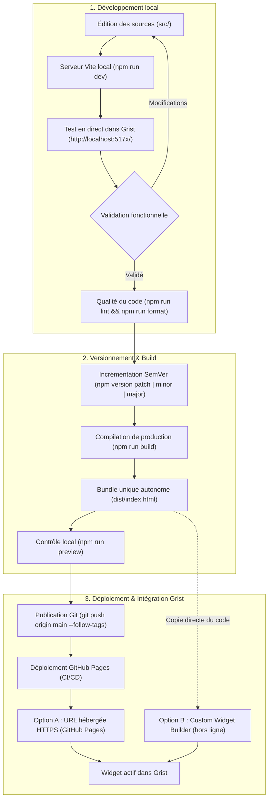

# Widgets Grist — PFSF / DNUM

Collection de widgets personnalisés pour [Grist](https://grist.numerique.gouv.fr/), développés et maintenus au sein de la DTNUM.

---

## 📦 Catalogue des widgets

| Widget                                                      | Description                                                           | Accès Grist       | URL d'intégration (GitHub Pages)                                         |
| ----------------------------------------------------------- | --------------------------------------------------------------------- | ----------------- | ------------------------------------------------------------------------ |
| [**Accordillon**](./accordillon/)                           | Vue tableau groupée et pliable avec tri et couleurs personnalisées    | Read table / Full | `https://dnum-mi.github.io/pfsf-grist-widgets/accordillon/dist/`         |
| [**Batch Emailing**](./batch-emailing/)                     | Composition et envoi groupé d'emails (gestion CCI, filtres, bilingue) | Read table        | `https://dnum-mi.github.io/pfsf-grist-widgets/batch-emailing/dist/`      |
| [**Timeline Grist Native**](./timeline_v2/)           | Vue chronologique avancée (TypeScript, Shoelace, GrainJS & réactive)  | Full              | `https://dnum-mi.github.io/pfsf-grist-widgets/timeline_v2/dist/`         |

---

## 🛠️ Architecture & Développement

Chaque widget est **totalement autonome** avec son propre environnement de build et de dépendances. Seules les configurations de qualité de code ([`eslint.config.js`](./eslint.config.js) et [`.prettierrc`](./.prettierrc)) sont partagées à la racine du dépôt :

```text
pfsf-grist-widgets/
├── eslint.config.js       # Configuration ESLint v9 partagée à la racine
├── .prettierrc            # Configuration Prettier partagée à la racine
└── example/
    ├── src/               # Code source (index.html, style.css, script.js)
    ├── dist/              # Build autonome tout-en-un (index.html)
    ├── vite.config.js     # Serveur HTTP local (port 5175) + plugin singlefile
    ├── package.json       # Dépendances locales, scripts et métadonnées Grist
    └── README.md
```

### Développement & Build (par widget)

```bash
# 1. Se positionner dans le dossier du widget
cd <widget>

# 2. Installer les dépendances du widget
npm install

# 3. Lancer le serveur de dev local en HTTP
npm run dev
# -> http://localhost:5174/ (accordillon)
# -> http://localhost:5175/ (batch-emailing)
# -> http://localhost:5176/ (timeline)
# -> http://localhost:5177/ (timeline_v2)

# 4. Linter les sources
npm run lint

# 5. Compiler pour la production (génère dist/index.html autonome dans le widget)
npm run build
```

---

## 🔄 Cycle de développement & déploiement



---

## 🚀 Utilisation dans Grist

1. Dans votre document Grist, ajoutez une vue : **Ajouter un widget → Personnalisé (Custom)**.
2. Dans le panneau de configuration à droite, sélectionnez **Custom URL**.
3. Renseignez l'URL GitHub Pages du widget (ou l'URL locale `http://localhost:<port>/` en cours de développement).
4. Sélectionnez le niveau d'accès approprié et mappez les colonnes requises.

---

## 🏷️ Versionnement & Releases

Chaque widget possède son propre cycle de version (SemVer) :

- **Source unique** : `package.json` (`version` et `grist.version`).
- **Métadonnées** : Balise HTML `<meta name="widget-version" content="X.Y.Z" />` injectée au build, et runtime `window.__WIDGET__.version`.
- **En production** : Version visible discrètement dans l'interface.
- **En développement (`npm run dev`)** :
  - Badge orange `🛠️ DEV vX.Y.Z` bien en vue dans l'en-tête / barre d'outils.
  - Titre de la page préfixé par `[DEV]`.
  - Message informatif dans la console navigateur.
- **Incrémentation & Tag Git** :
  ```bash
  cd <widget>
  npm version patch # ou minor, major
  npm run build
  git push origin main --follow-tags
  ```
